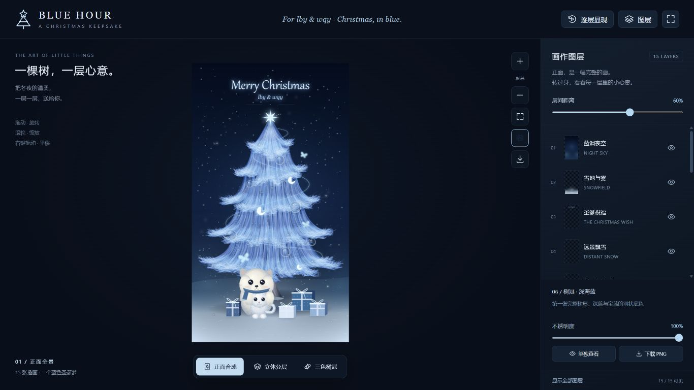

# BLUE HOUR · 蓝色圣诞树

> 把冬夜的星光、雪花和想说的话，装进一棵蓝色圣诞树。
>
> **Merry Christmas lby & wqy**

为 lby & wqy 制作的蓝色圣诞互动网页。15 张独立插画在三维空间中叠加：正面是一幅完整的冬夜画作，转动视角后，可以看见文字、雪花、树冠、装饰、猫狗与礼物各自所在的图层。点击礼物，再拆开一份随机送达的温柔。

*桌面构图预览；交互效果请打开网页体验。*

## 作品里有什么

- **可以转动的分层画作**：旋转、缩放、平移，切换正面合成、三维分层与树冠配色视图。
- **15 个独立图层**：不只拆开树的颜色，也能单独欣赏夜空、文字、积雪、树干、丝带、饰品、小狗、小猫、小爪和礼物。
- **精细的图层控制**：调整层间距与透明度，显示或隐藏图层，单独查看某一层，下载原始透明 PNG。
- **22 张暖心礼物卡**：点击礼物盒，播放开盒与卡片浮现动画，随机抽取原创短句；一轮内不重复，可继续“再拆一份”。
- **三首背景音乐**：《雪夜来信》《星光慢慢》《等你回家》，由程序合成并循环播放；支持暂停、切歌、调节音量和选择本机音乐。
- **冬夜的小细节**：飘雪、柔光、逐层显现动画、截图导出与全屏欣赏。
- **手机与电脑操作**：鼠标和触摸均可操作，手机端礼物入口采用紧凑布局。

## 打开作品

发布到 GitHub Pages 后，在线入口为：

**https://lby-cell.github.io/blue-christmas/**

也可以下载本仓库的 `index.html`，使用支持 WebGL 的现代浏览器打开。页面已内嵌渲染代码、插画和内置音乐，不需要安装依赖、运行构建命令或连接外部素材 CDN。

如果手机文件管理器无法将 HTML 交给浏览器打开，优先通过发布后的网页链接访问。

## 怎么玩

| 操作 | 电脑 | 手机 |
| --- | --- | --- |
| 旋转视角 | 鼠标左键拖动 | 单指拖动 |
| 放大、缩小 | 鼠标滚轮或页面缩放按钮 | 双指捏合或页面缩放按钮 |
| 移动画面 | 鼠标右键拖动 | 双指拖动 |
| 拆开礼物 | 点击礼物盒或“拆开一份心意” | 轻点礼物盒或礼物入口 |
| 查看分层 | 使用视图预设和图层面板 | 使用视图预设和图层面板 |

默认层间距为 **60%**，默认缩放为 **86%**，构图为猫狗和礼物留出了底部空间。可以按自己的屏幕调整。

电脑快捷键：`+` / `-` 缩放，`R` 回到正面，空格重新播放逐层显现；`Esc` 关闭卡片或音乐面板。

## 音乐与礼物

音乐面板可以切换三首内置曲目，也可以选择设备中的音频文件。本机音乐仅在本机播放，不会上传；刷新页面后需要重新选择。

页面进入时以 **100% 网页音量**尝试播放音乐，设备系统音量仍由自己控制。浏览器可能限制有声自动播放，此时轻点画面或点击播放按钮即可开启；网页无法强制绕过这一限制。手动暂停后，普通点击不会重新开启音乐。

礼物库包含 22 张原创暖心卡片，随机顺序在本轮内不重复，刷新后重新开始。卡片支持关闭、再抽一张，并会根据设备的“减少动态效果”设置简化动画。

## 图层一览

| 图层 | 内容 |
| --- | --- |
| 01–04 | 蓝调夜空、雪地与雾、圣诞祝福、远景飘雪 |
| 05–08 | 树干与投影、深海蓝树冠、冰川蓝树冠、银白雪丝 |
| 09–10 | 银光丝带、星星月牙与玻璃球 |
| 11–13 | 抱抱小狗、怀里的小猫、小爪与围巾 |
| 14–15 | 蓝色礼物盒、近景雪花与星光 |

所有插画图层使用同一张 **1080 × 1920（9:16）**画布对齐，便于正面合成、拆层和导出。

## 技术与部署

作品使用 **HTML、CSS、JavaScript、Three.js 与 Web Audio API**。透明插画平面沿深度方向排列，形成 2.5D 分层效果；侧面展示各张图层，背面仍为插画平面的背面。

仓库的 `index.html` 即完整网页入口，`preview.png` 为作品截图。直接将仓库根目录作为静态网站发布即可。

GitHub Pages 配置：进入 **Settings → Pages**，选择 **Deploy from a branch**，分支选 `main`、目录选 `/(root)`，保存并等待部署完成。之后修改 `index.html` 并提交，网页会随新的部署更新。

页面需要浏览器支持 WebGL；触摸操作和音频表现也受设备与浏览器能力影响。目前未在华为 Mate X5 真机上完成验证。

---

愿每一次打开，都能遇见一点星光，和一份被认真收藏的心意。
